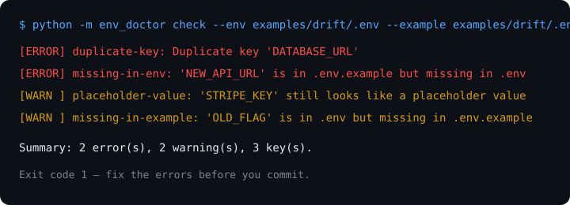

# env-doctor

Audit your `.env` files before they bite you: drift vs `.env.example`, duplicates, placeholders, risky secrets, and dead vars — in one command, with zero dependencies.

## Problem

Every new AI tool wants another API key, so `.env` files keep growing. In practice:

- `.env` drifts from `.env.example` — new devs miss a key, or old keys linger.
- A placeholder like `changeme` ships to production.
- A real secret ends up in a file that gets committed.
- Dead vars pile up and nobody dares to delete them.

`dotenv-linter` checks formatting. `env-doctor` checks **whether your env setup is actually correct**.

## Solution

One stdlib-only Python CLI. No dependencies, no network, no telemetry.

```
python -m env_doctor check --env .env --example .env.example
```

It reports:

| Check | What it finds |
|---|---|
| Drift | Keys in `.env.example` missing in `.env`, and vice versa |
| Duplicates | Same key defined twice |
| Placeholders | Empty values, `changeme`, `your-api-key`, `TODO`, `xxx`, ... |
| Risky secrets | Known prefixes (`ghp_`, `sk-`, `AKIA`, ...) or long high-entropy values |
| Unused vars | Keys not referenced in scanned code (`--scan .`) |
| Invalid lines | Lines without `=`, invalid key names |

Exit code `0` = no errors, `1` = errors found. Warnings never fail the run on their own, so you can use it in CI without false failures from heuristics.

## Demo



Or try it live:

```text
$ python -m env_doctor check --env examples/drift/.env --example examples/drift/.env.example
[ERROR] duplicate-key: Duplicate key 'DATABASE_URL' (line 3)
[ERROR] missing-in-env: 'NEW_API_URL' is in .env.example but missing in .env
[WARN ] placeholder-value: 'STRIPE_KEY' still looks like a placeholder value
[WARN ] missing-in-example: 'OLD_FLAG' is in .env but missing in .env.example
Summary: 2 error(s), 2 warning(s), 3 key(s).
```

## Install (3 steps)

```bash
# 1. Clone
git clone https://github.com/techdevfun/env-doctor.git
cd env-doctor

# 2. No dependencies to install (Python 3.9+ stdlib only).
#    Optional: install the `env-doctor` command
pip install -e .

# 3. Run it
python -m env_doctor check --env .env --example .env.example
```

## Runnable examples

```bash
# Clean setup — should pass
python -m env_doctor check --env examples/basic/.env --example examples/basic/.env.example

# Drift + placeholders — should fail with 2 errors
python -m env_doctor check --env examples/drift/.env --example examples/drift/.env.example || true

# JSON output for CI / scripts
python -m env_doctor check --env examples/drift/.env --example examples/drift/.env.example --format json

# Also flag vars not referenced in code
python -m env_doctor check --env .env --example .env.example --scan .
```

See `examples/` for the three setups: `basic/` (clean), `drift/` (broken on purpose), `ci/` (shell wrapper for CI).

### CI

Add this to your workflow:

```yaml
- name: Audit .env drift
  run: python -m env_doctor check --env .env --example .env.example --format text
```

This repo runs the same check in `.github/workflows/ci.yml` on Python 3.9, 3.11, and 3.12.

## Roadmap

- [ ] `--fix` to auto-add missing keys to `.env.example` as empty placeholders
- [ ] `--strict` to turn selected warnings into errors
- [ ] Support `.env.local`, `.env.production` layering checks
- [ ] SARIF output for GitHub code scanning

## License

MIT — see [LICENSE](LICENSE).
